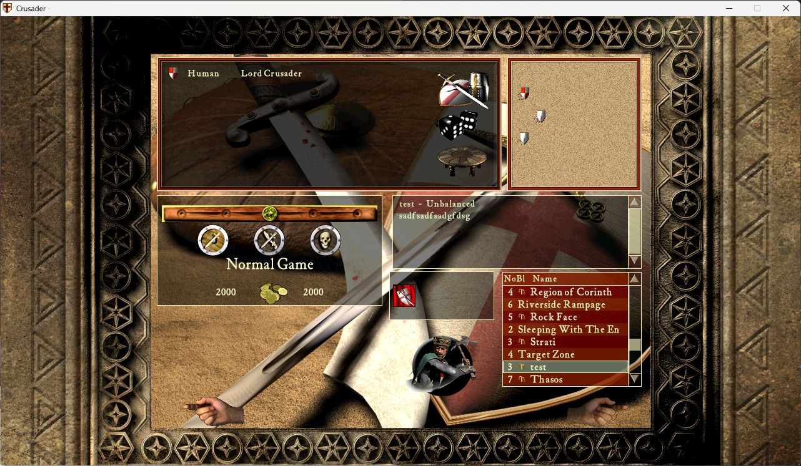
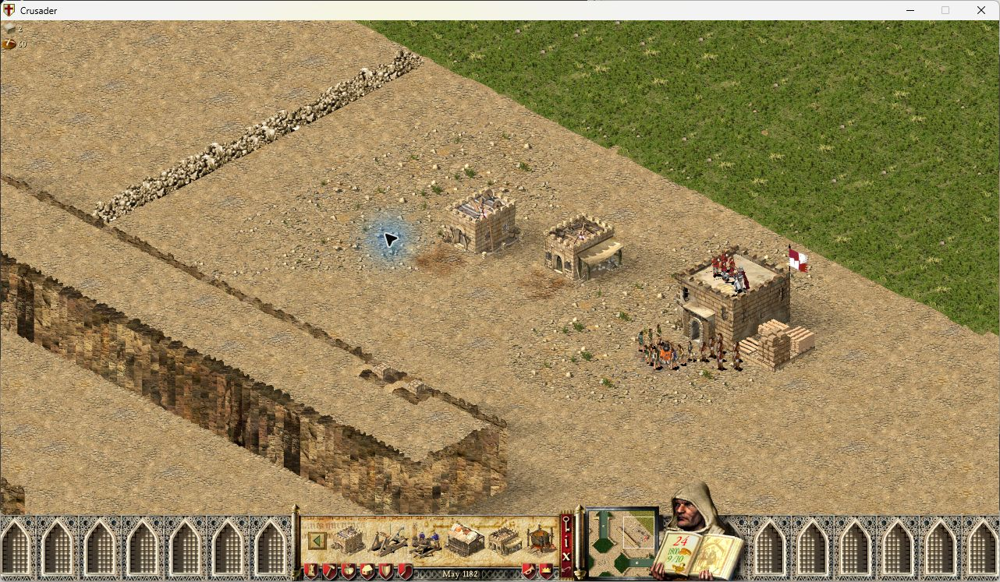
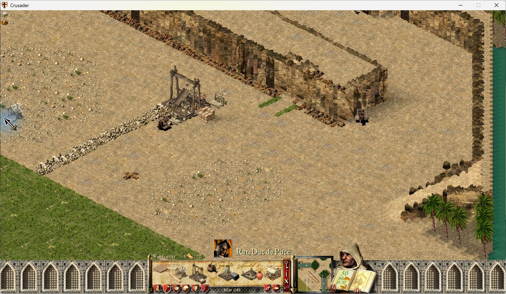
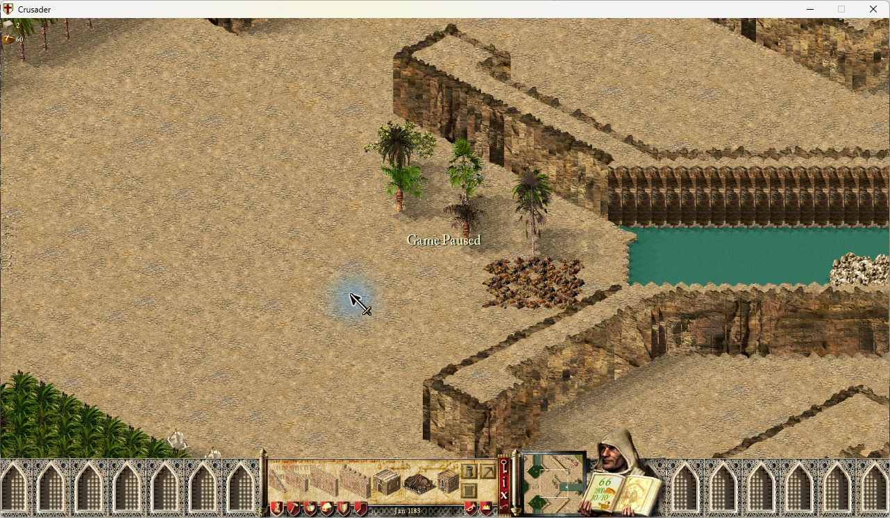
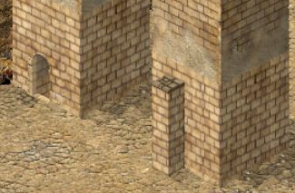
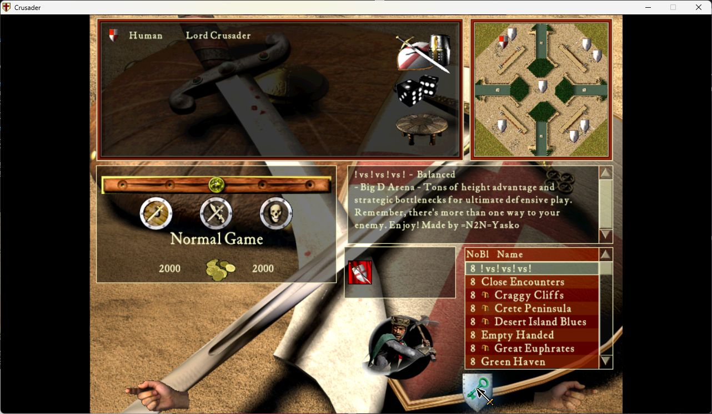

# Interface and Visual Fixes

Eight optional fixes for Stronghold Crusader and Crusader Extreme 1.41, using the game's existing
controls, text areas and artwork.

Version 0.2.0 ships the game's original behaviour: **every fix is off by default**, so
adding the module alone changes nothing. The "UCP3 Fixes" plugin turns on the five bug
fixes for building previews, dead trees, tower doors and cliffs; "UCP3 Recommended" also
turns on the two lobby features. Ghost Objects is not turned on by either plugin. You can
switch each fix on or off yourself. Values you saved in a configuration stay as they are;
if you added an earlier version on its own and update it, switch the fixes you want back on.
See the [short description](locale/description-en.md).

| Fix | Option URL | Default | Turned on by |
|---|---|---|---|
| Show lobby map descriptions | `interface-visual-fixes.lobby-map-descriptions` | off | UCP3 Recommended |
| Clear unique-building preview after placement | `interface-visual-fixes.clear-unique-building-preview` | off | UCP3 Fixes |
| Show building previews while scrolling | `interface-visual-fixes.building-preview-during-camera-movement` | off | UCP3 Fixes |
| Distinguish dead tree stages | `interface-visual-fixes.distinct-dead-tree-sprites` | off | UCP3 Fixes |
| Align tower doors with connecting walls | `interface-visual-fixes.tower-door-height` | off | UCP3 Fixes |
| Show Load in skirmish lobby | `interface-visual-fixes.lobby-load` | off | UCP3 Recommended |
| Continue cliff textures after rotation | `interface-visual-fixes.cliff-texture-direction` | off | UCP3 Fixes |
| Repair tile object lists (Ghost Objects) | `interface-visual-fixes.ghost-objects` | off | none |
| Ghost Objects interval (game ticks, 1 to 200) | `interface-visual-fixes.ghost-objects-interval` | 10 | none |

For an intermittent crash, keep the session's UCP logs before restarting.
[Crash reporting](docs/crash-reporting.md) explains the automatic startup
diagnostics and optional Windows dump capture. The reported blitter crash is
still under investigation; diagnostics are not a claim that it is fixed.

- **Show lobby map descriptions:** keeps custom descriptions visible when
  switching between custom and shipped maps.
- **Clear unique-building preview after placement:** deselects the marketplace,
  barracks, mercenary post and guilds after successful placement. Failed attempts
  can be retried; ordinary buildings and granary expansions keep repeat placement.
- **Show building previews while scrolling:** updates the existing preview while
  the camera moves.
- **Distinguish dead tree stages:** shows standing-dead art before fallen logs,
  without changing tree growth or saved state.
- **Align tower doors with connecting walls:** moves each doorway to the highest
  connected wall on its side, choosing the nearest to the side centre when heights
  tie. The doorway moves along the face as well as vertically; exposed cliffs
  beneath towers use the existing wall masonry.
- **Show Load in skirmish lobby:** makes the existing single-player Load control
  visible between the portrait and Start, including lobbies without an AI opponent.
- **Continue cliff textures after rotation:** makes cliff textures advance along
  both visible faces when the map is rotated, using the current texture pack,
  including taller cliff strips.
- **Repair tile object lists (Ghost Objects):** rebuilds each tile's list of small
  objects (flags, projectiles, dust, smoke, birds) from where each object really is,
  so stray flags, stones and arrows stop being drawn on an old tile. Based on
  Monsterfish's Ghost Objects Fix; see [credits](CREDITS.md).

Enable the module, switch on the fixes you want (or select a plugin that does),
apply your settings and restart the game. The module targets UCP 3.0.7 with
SHC or SHCE 1.41.

## Feature screenshots

### Lobby map descriptions

### Unique-building placement

### Camera movement

### Dead trees

### Tower doors

Highest wall wins on each side; among equally high walls, the connection nearest
the side centre wins. An exact tie uses the first tile in native boundary order.
A higher off-centre wall takes priority over a lower centred wall. Updated native
screenshots below show this selection and horizontal positioning.

Outermost connections place the door half a tile inward from the corner.
Ground-level stair6 connections work on their own; raised stair1–5 do not count.
Exposed cliffs beneath tower footprints use the current wall textures. Lower
connections create doors at their own height where that masonry backs the door.
Bare terrain and raised stairs do not supply doors.

If the selected high connection is removed, the door follows another high
connection before considering a lower one. The nearest-to-centre rule breaks
ties only between connections at the same height.

See [the native gallery](docs/r023/README.md) for the half-tile inset on wider towers.
Selection uses the game's existing connection refresh; warm drawing reads a
cache without rescanning walls. The measured added draw cost was about 0.024 ms for
1000 synthetic tower records. Foundation textures reuse the existing graphics
refresh and drawing pass. See [foundation validation](VALIDATION-TOWER-FOUNDATIONS.md)
for method and limits.

### Single-player lobby Load

### Cliff textures

Cliff textures continue across both faces in all four map orientations. The fix
uses the current texture pack and the existing drawing passes. Converted strips
are cached; repeated tile draws do not reprocess their pixels.

Front-facing diagonal steps use consecutive left/right strips: `[1|2] [3|4]`.
Straight sides advance one strip at a time. Steps receding into the view use
stable variation where their overlapping faces cannot form a continuous strip.

See [the current comparison, compatibility checks and measured cost](VALIDATION-CLIFF-UV.md).
See [diagonal sequencing and its native validation](VALIDATION-DIAGONAL-CLIFFS.md).

### Ghost Objects

The game links the small objects on each tile into a list. When an object is freed while
a list still reaches it, the next object created in that slot is drawn on the old tile
too, and saved games keep the tangle. On every N-th step of the game's own 200-tick
cycle (N is the interval, default 10; if N does not divide 200, the last gap before the
cycle restarts is shorter) the fix rebuilds all lists from each object's own tile, at the
start of the game's object update. That tick cycle is saved with the game and the same
for every player, so the schedule needs no extra save data and is identical after loading
a save, in multiplayer and in replays. All players in a multiplayer game, and a replay
when it is played back, need the same Ghost Objects setting as when it was recorded.

Improved Siege Engines' oil aim and oil spread options change the same object update.
If Improved Siege Engines has already changed it when Ghost Objects is on, **UCP stops at
startup with an error** that names `improved-siegeengines.oil.aim` and
`improved-siegeengines.oil.spread`; no fix of this module is installed. Turn those options
off (or Ghost Objects) and start again. If this module loads first instead, Improved Siege
Engines' oil feature turns itself off with a warning in the log and its other features
keep working. The reported river flag could not yet be reproduced in a native session,
so the visual repair is not confirmed in-game; see
[the native integration audit](docs/native-integration-audit.md) for what was checked.

## Validation

Native screenshots come from an isolated SHC 1.41 test installation with UCP3.0.7,
winProcHandler0.2.0 and graphicsApiReplacer1.3.0. Exact revisions, tests and limits:
[R007](VALIDATION-R007.md), [R130](VALIDATION-R130.md),
[R132](VALIDATION-R132.md), [R019](VALIDATION-R019.md),
[R023](VALIDATION-R023.md), [tower foundations](VALIDATION-TOWER-FOUNDATIONS.md), [R001](VALIDATION-R001.md),
[cliff textures](VALIDATION-CLIFF-TEXTURES.md).
Automated and original-code tests are distinguished from native results;
multiplayer, replay and broader compatibility are not inferred from them.
