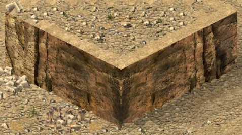

# Interface and Visual Fixes

Optional fixes for SHC/SHCE 1.41 and UCP 3.0.7, all off by default. The "UCP3 Fixes" plugin turns on the preview, tree, tower door and cliff fixes; "UCP3 Recommended" also turns on the two lobby features. Apply your settings and restart the game.

- توضیحات نقشه‌های سفارشی را در لابی نمایان نگه می‌دارد.
- پس از ساخت موفق ساختمان یکتا، پیش‌نمایش ساخت را پاک می‌کند.
- هنگام حرکت دوربین، پیش‌نمایش ساختمان را به‌روز می‌کند.
- درختان خشک ایستاده را از تنه‌های افتاده متمایز می‌کند.
- درهای برج را با محل اتصال هماهنگ می‌کند و سنگ‌چینی را زیر برج‌های لبهٔ پرتگاه ادامه می‌دهد.
- دکمهٔ بارگذاری موجود را در لابی تک‌نفره نشان می‌دهد.
- پیوستگی بافت صخره‌ها را پس از چرخش دوربین و در پله‌های مورب بهتر می‌کند.

پله‌های رو به دوربین از بافت‌های پیاپی استفاده می‌کنند؛ پله‌های رو به دوردست، هرجا هم‌پوشانی مانع پیوستگی شود، تنوع ثابتی دارند.

در، بلندترین اتصال معتبر را انتخاب می‌کند؛ در ارتفاع برابر، نزدیک‌ترین اتصال به مرکز برگزیده می‌شود. درهای کناری نیم خانه به داخل می‌روند. Stair6 ساخته‌شده به‌دست هوش مصنوعی به‌تنهایی درِ هم‌سطح زمین ایجاد می‌کند؛ پله‌های مرتفع حساب نمی‌شوند.

سنگ‌چینی زیر برج و درهایی هم‌ارتفاع با دیوارهای متصل.

بافت‌های پیوستهٔ پرتگاه پس از چرخش دوربین.

