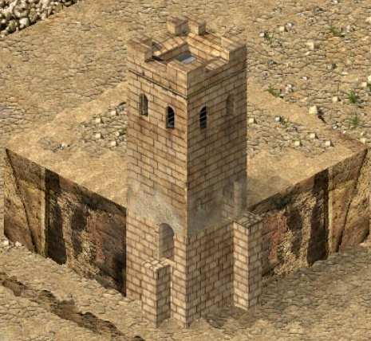

# Interface and Visual Fixes

Необязательные исправления для SHC/SHCE 1.41 и UCP 3.0.7. Примените настройки и перезапустите игру.

- Сохраняет описания пользовательских карт видимыми в лобби.
- Убирает предпросмотр после успешной постройки уникального здания.
- Обновляет предпросмотр здания при перемещении камеры.
- Отличает стоящие мёртвые деревья от поваленных стволов.
- Выравнивает двери башен по примыканиям и продолжает каменную кладку под башнями у края обрыва.
- Показывает существующую кнопку загрузки в одиночном лобби.
- Улучшает стыки текстур скал после поворота камеры и на диагональных уступах.
- Пересобирает списки объектов на клетках, чтобы посторонние флаги, камни и стрелы больше не появлялись на чужой клетке.

Кладка под башней и двери на высоте примыкающих стен.

Стыкующиеся текстуры обрывов после поворота камеры.

